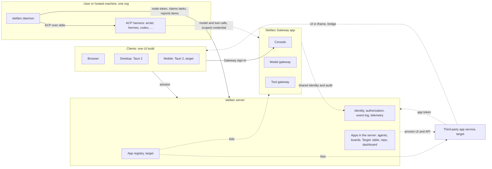

# ADR 0015: Stellarc is a foundation of apps — server, daemon, one UI on three clients; arclet is a separate harness

Status: **proposed** (2026-11-12; revised 2026-11-13 after design reviews R1 to
R3, see *Review*).

Operator direction, 2026-11-11/12: "we need to
make our system a super-app like … each subsystem is an app (llmgw, mcpgw,
resources (boards, table, repo, dashboard), and other custom apps) … make it
possible for user to expand stellarc through apps. these apps can be plug and
play. call it stellarc server and stellarc daemon … arclet will be fully
separate from stellarc … stellarc is just the 'foundation' of the whole system."
And: "make them as Gateway in general … Model gateway, Tool gateway, etc are
subset/subsystem of Stellarc Gateway."

How this relates to earlier decisions:

- **Amends ADR 0002**: component names, which component "arclet" refers to, and
  which of the daemon's duties are built (§7).
- **Confirms ADR 0011**: machines attach through a daemon, agents are ACP
  harnesses.
- **Amends ADR 0009 §Target platforms**: mobile was deferred there until "the
  owner re-charters it". The 2026-11-11 direction ("easy way of managing
  desktop+web and mobile app") is read here as that re-charter.
- **Amends ADR 0014 §4**: drops "Expo later", the Expo persistence adapter, the
  "Capacitor/Expo webviews" clause and the React Native charts note. Desktop
  and mobile are both Tauri 2, which is also what ADR 0009 already ruled ("No
  second UI stack").
- **Takes over the unmerged ADR 0013 proposal** (PR #87, commit `00fe89d`) and
  retargets it from `apps/stellarc-ui` to `apps/web`.
- **Charter** (D1–D19): three departures, all in §6. The Gateway is an
  exception to D5, D6 and D11. "App" is used more broadly than in D2. An app
  acting through a token is a kind of actor D12 does not list. The rest is
  unchanged.

Sections 1–4 record operator decisions. Sections 5–7 are proposals made to carry
them out and are what review should challenge.

## Glossary

| Term | Meaning | In the repo today |
|---|---|---|
| **stellarc server** | The control plane: identity, event log, API, app registry. | `apps/stellarc-api` |
| **stellarc daemon** | Per-machine connector. Holds harness binaries and credentials, claims tasks, drives harnesses over ACP. | `apps/stellarc-node` (Bun/TypeScript) |
| **app** | The unit a user sees, installs and switches on per org. A product word: it covers both a charter *plugin* (runs in the server) and a charter *app* (runs as its own service). | no manifest or registry yet |
| **first-party app** | Shipped with Stellarc, or installed by the plane operator at deploy time. | `packages/agents`, boards, the Gateway |
| **third-party app** | Added by a user or an org. | none yet |
| **app token** | Short-lived credential the server mints for one app in one org. Two kinds: a *frame token* also names the user, a *backend token* does not (§6). | not built |
| **apps domain** | A separately registered domain, one per deployment, under which each third-party app gets its own hostname. Never a subdomain of the domain the shell or the API uses. | not built |
| **Stellarc Gateway** | One app that owns all gateway work. | `apps/stellarc-gateway` |
| **Model gateway / Tool gateway** | Subsystems of Stellarc Gateway. | `apps/llmgw`, `apps/toolgw` |
| **harness** | Any local process that speaks ACP over stdio (ADR 0011). | daemon defaults: hermes, goose, claude-code, codex, gemini, opencode |
| **arclet** | Stellarc's native agent harness. A separate product. | not in this repo |

These documents use "arclet" for the node daemon: ADR 0002, 0004 and 0007, the
charter (topology line, D14, D18), `docs/transcript-schema-v2.md`,
`docs/steal-reject-matrix.md` and `docs/spikes/auth-llmgw-maple.md`. Read those
uses as "stellarc daemon". ADR 0002 also calls the daemon Rust; the daemon that
exists is the Bun/TypeScript one ADR 0011 built.

## Decisions (operator)

1. **Names.** The control plane is the stellarc server; the per-machine
   connector is the stellarc daemon. These are product and documentation names
   now. Renaming the `apps/stellarc-api` and `apps/stellarc-node` directories is
   a mechanical follow-up, not part of this ADR.
2. **Every subsystem is an app.** Gateway, the resource apps (boards, table,
   repo, dashboard) and custom apps are peers. Users extend Stellarc by adding
   apps. Stellarc itself is the foundation they share: identity, authorization,
   event log, telemetry.
3. **Stellarc Gateway is one app.** The Model gateway and Tool gateway are
   subsystems inside it, and later gateways join the same way. `core-auth` stays
   a core module the gateway consumes. This replaces the earlier plan of
   separate `llmgw` and `toolgw` apps (recorded in
   `docs/spikes/stellarc-replacement-map.md` §Destination).
4. **Execution model.** Per-user native Linux userspace is dropped: it does not
   scale. Machines attach through the daemon and agents are ACP providers, which
   is ADR 0011 as built. **arclet** is the native harness, separate from
   Stellarc: tuned for one environment and not meant to run anywhere. It
   requires a Linux host (sandbox or VM) with a copy-on-write filesystem, is
   durable by design, and enforces its own lightweight sandbox and file
   management. It is offered serverless, or installed by the user.

## Proposals

### 5. One UI codebase, three clients

`apps/web` is the only UI. Tauri 2 wraps the same static build for desktop and
for iOS and Android. No second UI in React Native or Expo.

- `apps/web` already builds as a static SPA that a Tauri webview can load: a
  prerendered shell with relative asset paths, written to
  `apps/web/dist/client` (`apps/web/vite.config.ts`, ADR 0014 §4).
- `apps/web` still reads local fixture data
  (`apps/web/src/data/collections.ts`). ADR 0014 sequence step 5 (NEVR-434)
  replaces the fixtures with synced collections. Until then it cannot replace a
  working client.
- `desktop/` is a Tauri 2 shell that still bundles the old UI. Switching it is
  more than one path: `frontendDist` in `desktop/tauri.conf.json`,
  `desktop/scripts/build-ui.sh` and the descriptions in `desktop/Cargo.toml`
  and `desktop/src/lib.rs` all name `stellarc-ui`, and the content-security
  policy was tuned for the old bundle.
- The desktop crate already declares the library types mobile needs
  (`desktop/Cargo.toml`: `staticlib`, `cdylib`, `rlib`) and the mobile entry
  point (`desktop/src/lib.rs`). No mobile project has been generated (there is
  no `desktop/gen`).
- Alternatives. The ADR 0013 proposal (PR #87 at `00fe89d`) scores three
  options: Tauri 2 (23/25), React Native / Expo (12/25) and Dioxus (8/25). It
  assesses GPUI, Flutter, Lynx, Electrobun and Capacitor briefly, without
  scores. Its constraints cite the frozen UI surface and ADR 0012. ADR 0014
  dropped the freeze and superseded ADR 0012, but kept the Effect API client
  that constraint was about. What carries over is target coverage, TypeScript
  and API-client reuse, and ecosystem. Its "migration cost" row was scored
  against the frozen UI and is not reused. The conclusion is the same for
  `apps/web`, which is also a React-DOM app: React Native means a second UI,
  Dioxus means a rewrite.

Not verified: `apps/web` has not been built and run inside the Tauri desktop
shell (this rests on its config and build output), no mobile target has been
built from this repo, and iOS builds need a Mac.

### 6. What an app is

An app is a manifest plus a registry entry. The manifest names what the app
adds: an id, an event namespace, its migrations, its HTTP routes, the
capabilities it asks for, where it runs, and an optional UI entry. Install is
plane-wide and activation is per org (charter D8, D3).

**What exists to build on**

- Events already carry the owning module: the `event` table has a `plugin_type`
  column (`packages/db/migrations/0001_foundation.sql`), and the agents module
  writes `agents:<type>` into it (`PLUGIN` in `packages/agents/src/store.ts`).
- `packages/agents` is close to app-shaped: namespaced events and an HTTP group
  exposing `matches` / `handler` / `dispose` (`packages/agents/src/http.ts`)
  that the server mounts (`apps/stellarc-api/src/main.ts`).
- `gatewayApp()` in `apps/stellarc-gateway/src/main.ts` returns the same
  `handler` / `dispose` shape, but runs as its own process, at its own origin,
  with its own database connection and `gw_*` tables.

**What is new**

| New piece | Why what exists does not cover it |
|---|---|
| Manifest type | Nothing declares an app today. |
| Registry table and per-org activation rows | There is no record of which apps are installed or active. |
| Activation check at dispatch | The server imports `agentsHttp` directly and matches it before any other route, behind one static operator token for every org (`apps/stellarc-api/src/main.ts`). No org can switch it off. |
| Per-app ownership of migrations | Migrations are one ordered, checksummed list (`packages/db/src/migrate.ts`). The agents tables are spread over `0003`–`0007` and `0009`. |

**Where an app runs**

The manifest says which of two places:

| | In the server | As its own service |
|---|---|---|
| Charter term | plugin in venue `main` (D2) | app (D2: out of process) |
| Trust | Full: shares the server's process and database. | Only what its app token grants. |
| Who may ship one | First-party only. | Anyone. The only place for a third-party app. |
| Today | agents, boards | the Gateway |

A third-party app never runs in the server: charter D2 gives `main` full trust,
and D8 says per-org custom code is an app. The charter's third venue,
`isolate` (a sandbox the server owns), is not built and this ADR does not build
it. If it is built later it becomes a second place for third-party code.

First-party apps get no shortcut around grants. They declare capabilities in
the same manifest, and an org's grant set is what activates them (D5, D8).

`docs/primitives-v1.md` calls a board "an app, not a kind". ADR 0014 §1 built
boards as server tables (`packages/db/migrations/0008_stellarc_domain.sql`). In
this ADR's terms boards are a first-party app in the server.

**How a service app is reached and authorized**

- **Default: proxied (charter D11).** The server answers for the app's hostname
  under the apps domain and forwards to the app's service. It never serves an
  app's HTTP responses from its own origin: HTML or script returned there would
  run with the API's origin. An app's MCP tools are different. The server's MCP
  surface relays them as data under the app's namespace and checks
  capabilities there (D11).
- **Exception, Gateway only.** The Gateway is reached at its own origin and is
  not proxied. D11 lets the gateway front the server but "never bypass its
  checks". Today the Gateway does not use the server's checks at all: it has
  its own sign-in, its own database, its own principal table (`gw_principal`,
  `packages/core-auth/src/store.ts`) and its own `/mcp` surface, and it
  authorizes each call against that store (`store.authorize` in
  `apps/stellarc-gateway/src/main.ts`). The server's authorization for its own
  domain routes currently refuses every request (`AuthzLive`,
  `packages/domain/src/authz.ts`). This also makes the Gateway a privileged
  built-in, which D5 does not allow outside the kernel, and gives Stellarc a
  second MCP surface, where D6 and D11 give the kernel the only one. The
  exception ends when the Gateway's per-call decisions are made against the
  server's grants; one shared sign-in is not enough (see *Open*). No other app
  gets this exception.

**App tokens**

Two kinds, both minted by the server and short-lived:

| | Frame token | Backend token |
|---|---|---|
| Names | app, org and user | app and org |
| Allows | Only what both the user's own rights and the org's grants to the app allow (D3). | The org's grants to the app. |
| Obtained by | The shell, for the signed-in user. Handed to the frame over the bridge. | The app's service, in exchange for a client credential registered at install. The server keeps a hash or an external-store reference, never the value (D16). |
| Logged as | actor: the app, on behalf of the user | actor: the app |

On every call the server checks the token's audience and expiry, the org's
activation row, and the grants as they are now, not as they were when the token
was minted. Switching an app off or narrowing its grants takes effect on its
next call.

D12 lists humans, agents and workflows as actors. An app acting through a token
is a fourth kind, added here. `core-auth` already implements this shape for an
agent acting on behalf of a person (`gw_delegation`: actor, subject, audience,
actions, expiry, narrowing only; `packages/core-auth/src/store.ts`). App tokens
are that shape with an app as the actor, not a second model. Only the Gateway
uses `core-auth` today; the server does not import it.

**App UI**

| Who wrote it | How its UI ships | Installs without a rebuild |
|---|---|---|
| First-party | Route modules compiled into `apps/web`, listed from the registry. | No |
| Third-party | Served under the apps domain, shown in an iframe, talking to the shell over a message bridge. | Yes |

Third-party UI installs at runtime: the operator's direction is that apps are
"plug and play". It is built last (step 5), when the first third-party app
exists. Step 5 opens with its own ADR and security review before any code.
These rules bind it:

1. **Origin and site.** Each third-party app gets a hostname of its own under
   the apps domain (`<app-id>.<apps-domain>`), and the server answers for it.
   - The apps domain is registered separately. It is never a subdomain of the
     domain the shell or the API uses, and never a path under either. A
     subdomain is a different origin but the same site: the browser would
     still send the user's same-site cookies with the app's requests, and the
     app could set cookies for the parent domain.
   - The legacy sign-in can scope its cookie to a parent domain
     (`COOKIE_DOMAIN`, `packages/kaneo-legacy/src/auth.ts`). No session cookie
     may be scoped to a domain that contains the apps domain.
   - That sign-in also sets `SameSite=None` when the API and the client are on
     different hosts over HTTPS. A cookie set that way is sent on cross-site
     requests (platform knowledge), so a separate site alone does not keep it
     away from a call an app's script makes to the API. The apps domain is
     never a trusted origin or a CORS origin of the server (`trustedOrigins`,
     `CORS_ORIGINS`), and any route that accepts a cookie refuses a request
     whose `Origin` is under the apps domain. A frame reaches Stellarc through
     the bridge or through its own service, never by calling the API itself.
   - On app hostnames the server removes `Cookie` from requests and
     `Set-Cookie` from responses, and adds no credential of its own. A request
     on an app hostname goes only to that app, never to the server's own
     routes.
   - Sibling apps share the apps domain, so script in one app can still set a
     cookie that script in another can read. Apps must not rely on cookies.
     Putting the apps domain on the Public Suffix List removes this; that is
     optional, and slow for a self-hosted deployment.
   - One apps domain also lets the desktop shell name a single `frame-src`
     pattern at build time while apps are still added at runtime.
2. **Frame.**
   - The frame's `sandbox` allows scripts, forms and the frame's own origin.
     It never allows top-level navigation or popups that escape the sandbox.
   - The frame's `allow` list (camera, microphone, location and the like) is
     empty unless the org granted that capability.
   - App hostnames send `frame-ancestors` naming only the shell's origins, so
     no other site can frame an app and pose as the shell.
3. **Bridge.** One `MessageChannel` per frame load.
   - The shell hands over the port only after it has checked the frame's
     `event.origin` and `event.source` against the app's registry entry. It
     posts the port to that registered origin, never to `"*"`.
   - When the frame reloads, the shell closes the old port and makes a new
     channel.
   - The app accepts a port only from a shell origin: the web origin, and the
     origins the Tauri webview uses (`tauri://localhost`,
     `http://tauri.localhost`; platform knowledge).
4. **Credential.** The frame receives a frame token over the bridge. Never the
   user's session and never a cookie. Safari and iOS webviews partition or
   block third-party cookies inside an iframe (platform knowledge, not tested
   here), so a cookie design would behave differently per client.
5. **Desktop and mobile shell.** `desktop/tauri.conf.json` sets
   `default-src 'self'` with no `frame-src`, so the desktop app blocks every
   such frame today. Step 5 adds `frame-src` for the apps domain.
   - Tauri's documentation says its API is "only accessible to bundled code"
     unless a capability lists remote URLs (*Capabilities → Remote API
     Access*). It does not say how a remote iframe inside the main webview is
     treated.
   - No capability may carry a `remote` entry. Today there is no capability
     file and the shell registers no commands of its own; it does load
     `tauri-plugin-shell` (`desktop/src/lib.rs`).
   - The main webview must refuse navigation away from the bundled UI, so a
     frame cannot replace the shell with a remote page inside the app's
     window. The shell has no such guard today.

Not verified, and owed by step 5's ADR: how Tauri treats a command call from a
remote iframe; whether `frame-ancestors` accepts the Tauri webview origins; how
Safari and iOS webviews treat cookies in the frame.

The iframe is the only form that installs at runtime on all three clients. It
costs a narrower integration (the frame gets what the bridge exposes and
nothing else) and a second registered domain, with a wildcard DNS record and
certificate, on every deployment that allows third-party apps, self-hosted
ones included.

### 7. Where arclet runs

arclet attaches as one more ACP harness: a daemon config entry, no
arclet-specific code in Stellarc. When Stellarc hosts it for a user, it runs
under a daemon on server-owned Linux machines. A daemon belongs to exactly one
org (`agent_node.org` is `NOT NULL`,
`packages/db/migrations/0003_agents.sql`), so hosting means one daemon per org
per sandbox or VM, and a hosted sandbox or VM is never shared between orgs.
arclet never runs inside the server process, so the server still runs no agent
loop (charter D4).

ADR 0002 and the charter gave the node daemon a list of duties. With arclet
now a separate harness, they split as follows:

| Duty (ADR 0002; charter D15, D18) | Owner now | Built |
|---|---|---|
| Host effects, driving harness processes | daemon | Yes (ADR 0011) |
| Local journal and replay after a network partition (D15) | daemon | No |
| Dropping duplicate steps by idempotency key (D18) | daemon | No |
| Copy-on-write workspaces | arclet, inside its own sandbox. Not decided for other harnesses. | No |
| iroh endpoint | Not decided here. The daemon calls the server's HTTP API (ADR 0011); ADR 0004's tunnel stays a standalone component. | No |

Solid lines exist in source. Dotted lines are targets.

**Controls at each boundary**

| Boundary | What crosses it | Checked by | In source today |
|---|---|---|---|
| Client → server | User session | server | Sign-in is the legacy Kaneo mount (better-auth at `/api/auth`). Authorization for the server's own domain routes refuses everything (`AuthzLive`); the agents routes sit behind one static operator token. |
| Client → Gateway console | Gateway session, from the Gateway's own sign-in | Gateway (`core-auth`) | Built |
| Daemon → server | Node token. Reports are claims (charter D14). | server | Built |
| Daemon → harness | A fixed environment: `PATH`, `HOME`, `TMPDIR`, `LANG` and the harness spec's own `env`. Never the node token. | daemon (`harnessEnv`, `apps/stellarc-node/src/runner.ts`) | Built |
| Harness → Gateway | Scoped Gateway credential | Gateway, `store.authorize` on every call | Gateway side built. The daemon neither mints nor passes a Gateway credential; an operator can only put one in the harness spec's `env` by hand. |
| Gateway → server | Shared identity; audit into the server's event log | server | Not built. The Gateway audits to `gw_audit` and exports over OpenTelemetry (`packages/core-auth/src/audit.ts`). |
| Server → app service | The forwarded request, without `Cookie`. No user session and no server credential. | app service | Not built |
| App service → server | Backend token, or a frame token passed on by the frame | server: audience, expiry, activation row, current grants | Not built |
| Third-party frame → shell | Bridge port, frame token | shell | Not built |

**Where provider and tool credentials live**

Target: only in the Gateway, so no client, daemon or harness holds one. That is
the route charter D16 recommends ("routed via the builtin aiproxy"); D16 also
allows keys held on the node. Today:

- Harness keys are on the machine: ADR 0011 passes them through the harness
  spec's `env` in the daemon config.
- An agent's MCP server definitions carry `env` name/value pairs (`McpServer`,
  `packages/agents/src/protocol.ts`) and are stored in `agent.mcp_servers`, so
  a tool secret can sit in the server database. D16 says the server holds
  references, never values.
- The Gateway reads its provider secret from its own environment
  (`GATEWAY_PROVIDER_SECRET`).

Reaching the target needs the harness → Gateway edge first.

## Rejected

| Option | Why not |
|---|---|
| Per-user native Linux userspace on the server | Operator: does not scale. One OS account per user also ties tenancy to a host. |
| Separate `llmgw` and `toolgw` apps | Operator: one Gateway. They also share ingress, admission and audit, which is why one process hosts both today. |
| A second UI for mobile (React Native / Expo) | Two UIs to keep in step; no Linux desktop target (ADR 0013 proposal). ADR 0009 already ruled it out. |
| Third-party code in the server process | Charter D2: venue `main` is full trust. |
| Third-party UI loaded as code into the shell (module federation) | Runs untrusted code in the shell's origin with the user's session. |
| Third-party UI or app HTTP under a path on the server's or the shell's origin | Same origin as the shell or the API, so the same exposure as above. |
| Apps domain as a subdomain of the shell's or the API's domain | Same site: the user's same-site cookies travel with the app's requests, and the app can set cookies for the parent domain. |
| arclet as a module of the server | Puts an agent loop in the control plane (charter D4). |

## Open

- **Console labels.** The gateway console labels the subsystems "LLM GATEWAY"
  and "MCP GATEWAY" (`apps/stellarc-gateway/src/console.html`). Renaming them to
  Model gateway and Tool gateway is a visible change and waits for the
  operator's OK.
- **One org identity.** The server's `organization.id`, the free-text `org` on
  events and on the agents tables, and the Gateway's `gw_principal.org` are
  three identifiers with no constraint linking them. Step 1 starts by choosing
  one key and recording how the other two map to it.
- **Gateway under the server's grants.** One human identity across the server
  and the Gateway, and the Gateway's per-call decisions made against the
  server's grants. The exception in §6 ends only with the second.
- **Mobile.** This ADR reads the 2026-11-11 direction as putting mobile back in
  scope (ADR 0009 had deferred it). The operator confirms or corrects that
  reading.
- **Partition journal (D15) and duplicate suppression (D18)** are daemon duties
  and are not built.
- **MCP `env` values in the server database** contradict D16.

## Sequence

1. Choose one org key and record how the other org identifiers map to it (see
   *Open*). Then the app manifest type, registry table and per-org activation
   rows; list apps from the server; register `agents` and the Gateway as the
   first two entries.
2. Activation and grant check at dispatch for apps that run in the server.
3. Drive `apps/web` navigation from the registry instead of the fixed route map
   (`apps/web/src/components/shell/nav.ts`).
4. Point `desktop/` at `apps/web` once `apps/web` reads real data (ADR 0014
   step 5, NEVR-434). Then, once the operator confirms mobile (*Open*),
   generate the Android and iOS projects.
5. Third-party apps, opening with their own ADR and security review: apps
   domain, app tokens, iframe host and message bridge. Built when the first
   third-party app exists.

## Consequences

- "arclet" in the documents listed under the glossary now reads as "stellarc
  daemon"; those documents are not edited.
- Mobile is back in scope (ADR 0009 had deferred it), once the operator
  confirms that reading (*Open*).
- `apps/stellarc-ui` stays the shipped desktop bundle until step 4.
- A deployment that allows third-party apps needs a second registered domain,
  with a wildcard DNS record and certificate, as its apps domain.
- Nothing in Stellarc depends on arclet existing: any ACP harness fills the
  same slot.

## Review

R1: independent read-only design review of commit `ac30a4a`, 2026-11-13.
Verdict: changes required, 6 must-change (M) and 11 should-fix (S). The full
report is a comment on PR #256. Every finding that cites source was checked
against it, and all 17 were applied. S9 rests on platform knowledge and is
labelled so in §6. Source is cited by file and symbol; the review's line
numbers moved when `effect/v4` was merged in.

| Finding | Severity | Applied as | Where |
|---|---|---|---|
| M1 "app" differs from charter D2; who may run in the server | Must | First-party only in the server; third-party always a service; `isolate` named as not built; "app" defined as a product word; header no longer says the charter is unchanged | header, glossary, §6 |
| M2 D11 does not cover the Gateway's own origin | Must | Recorded as an exception this ADR adds, Gateway only; today's separate identity stated | header, §6, Open |
| M3 "credentials live only in the Gateway" is false today | Must | Split into target and today; D16 cited; the two unbuilt edges marked | §7 |
| M4 iframe and bridge boundary undefined | Must | Four rules: origin, bridge, credential, shell. App token defined for frame and backend. The review proposed generating `frame-src` from the registry; one apps domain is used instead, because the desktop policy is fixed at build time and apps are added later | glossary, §6 |
| M5 "no new mechanism" overstated | Must | Sentence removed; "What is new" table added | §6 |
| M6 "Extends ADR 0014" is an amendment | Must | Header says "Amends ADR 0014 §4" | header |
| S1 desktop switch would ship fixture data | Should | Gated on NEVR-434 and moved to step 4; the files that name `stellarc-ui` listed | §5, Sequence, Consequences |
| S2 desktop load unverified | Should | Added to "Not verified" | §5 |
| S3 ADR 0013 scoring "carries over unchanged" | Should | States what was scored, what was not, and which rows carry over; cites `00fe89d` | §5 |
| S4 "arclet" also appears outside ADR 0002/0004/0007 | Should | Rule widened to every document before 2026-11-11, files listed | glossary, Consequences |
| S5 owner of D15 journal and D18 dedupe | Should | Duty table: daemon owns both, neither built | §7, Open |
| S6 hosted arclet tenancy unit | Should | One daemon per org per sandbox or VM | §7 |
| S7 diagram gaps | Should | Client → Gateway and app → server edges added; built and target lines distinguished | §7 |
| S8 server and Gateway orgs are separate | Should | Listed as Open; step 1 depends on it | Open |
| S9 "behaves the same" on all clients | Should | Claim narrowed; cookies ruled out, token over the bridge | §6 |
| S10 `plugin_type` cited to the wrong file | Should | Cites the migration and the agents store | §6 |
| S11 console labels misquoted | Should | Quoted exactly | Open |

Changed by the author, not raised in review:

- The ADR 0009 amendment (mobile).
- The apps domain, which lets "served by the server", "separate origin" and
  "installs at runtime on desktop" hold at the same time.
- The earlier open question, whether third-party UI must install at runtime,
  is closed as yes and built last. Nothing before step 5 depends on it.
- Sequence reordered: registry first, desktop switch after `apps/web` reads
  real data.

R2: independent read-only delta review of `d9ce8f7`, 2026-11-13. Verdict:
changes required. It found 15 of the 17 R1 findings closed and two partly
closed (M4, S8), and raised 10 new findings (N), 3 must and 7 should. The full
report is a comment on PR #256. All 10 are applied; they also close M4 (N1–N5)
and S8 (N7).

| Finding | Severity | Applied as | Where |
|---|---|---|---|
| N1 a subdomain of the shell's domain is a separate origin but the same site | Must | Apps domain is registered separately; no session cookie scoped over it; the server removes `Cookie` and `Set-Cookie` on app hostnames; the sibling-cookie residue is stated. The review also proposed removing `Authorization`; not applied, because the browser never sends that header on its own and it is how a frame token reaches the app's own service | glossary, §6 rule 1, Rejected |
| N2 app token names no user; backend credential unnamed; grants not rechecked | Must | Frame token and backend token; client credential kept by hash or reference; grants checked on every call; reuses the `core-auth` delegation shape | glossary, §6 |
| N3 proxying under a namespace on the API's origin | Must | App HTTP is served only on the app's hostname; MCP tools are relayed as data | §6 |
| N4 bridge checked from one side only | Should | Frame rule added; bridge rule covers target origin, reload and the app's own check | §6 rules 2–3 |
| N5 Tauri statement does not cover iframes | Should | Quoted as written; the iframe case listed as not verified; no `remote` entries; navigation guard | §6 rule 5 |
| N6 other charter departures not named | Should | D5 and D6 named under the Gateway exception; the D12 addition named; first-party apps go through the same grants; charter cited as D1–D19 | header, §6 |
| N7 step 1 needs the org mapping that Open says is missing | Should | Step 1 starts with the org key | Sequence, Open |
| N8 mobile stated as settled | Should | Listed as a reading the operator confirms | Open, Consequences |
| N9 a shared sign-in does not end the D11 exception | Should | Ends when the Gateway decides against the server's grants | §6, Open |
| N10 ADR 0014 clause missed; a listed document postdates 2026-11-11; no server → app row | Should | Clause added; the date test dropped in favour of the list; row added | header, glossary, §7 |

R3: independent read-only closure check of `68ba82f`, 2026-11-13. Verdict:
cleared with edits. It found N2–N10 and S8 closed and N1 (and so M4) partly
closed, judged the declined `Authorization` remedy sound as long as an app
hostname routes only to its app, and listed three edits (E) as the complete set
needed to clear. All three are applied, so the clearance condition is met. No
further review was run on these three edits.

| Finding | Applied as | Where |
|---|---|---|
| E1 the legacy session cookie is `SameSite=None` across hosts, so a separate site does not withhold it (closes N1, M4) | Apps domain is never a trusted or CORS origin; cookie routes refuse an `Origin` under it; a frame never calls the API itself; an app hostname routes only to its app | §6 rule 1 |
| E2 the Rejected row covered UI only | Row covers app HTTP too | Rejected |
| E3 step 4 committed to mobile before the operator confirms | Mobile projects wait for the confirmation | Sequence |
