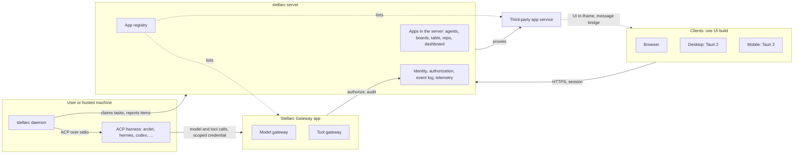

# ADR 0015: Stellarc is a foundation of apps — server, daemon, one UI on three clients; arclet is a separate harness

Status: **proposed** (2026-11-12). Operator direction, 2026-11-11/12: "we need to
make our system a super-app like … each subsystem is an app (llmgw, mcpgw,
resources (boards, table, repo, dashboard), and other custom apps) … make it
possible for user to expand stellarc through apps. these apps can be plug and
play. call it stellarc server and stellarc daemon … arclet will be fully
separate from stellarc … stellarc is just the 'foundation' of the whole system."
And: "make them as Gateway in general … Model gateway, Tool gateway, etc are
subset/subsystem of Stellarc Gateway."

Amends ADR 0002 (component names; which component "arclet" refers to). Confirms
ADR 0011 (machines attach through a daemon, agents are ACP harnesses). Extends
ADR 0014 (clients). Takes over the decision of the unmerged ADR 0013 proposal
(PR #87) and retargets it from `apps/stellarc-ui` to `apps/web`. The charter
(D1–D20) is unchanged.

Sections 1–4 record operator decisions. Sections 5–7 are proposals made to carry
them out and are what review should challenge.

## Glossary

| Term | Meaning | In the repo today |
|---|---|---|
| **stellarc server** | The control plane: identity, event log, API, app registry. | `apps/stellarc-api` |
| **stellarc daemon** | Per-machine connector. Holds harness binaries and credentials, claims tasks, drives harnesses over ACP. | `apps/stellarc-node` (Bun/TypeScript) |
| **app** | The unit a user sees, installs and switches on per org. | no manifest or registry yet |
| **Stellarc Gateway** | One app that owns all gateway work. | `apps/stellarc-gateway` |
| **Model gateway / Tool gateway** | Subsystems of Stellarc Gateway. | `apps/llmgw`, `apps/toolgw` |
| **harness** | Any local process that speaks ACP over stdio (ADR 0011). | daemon defaults: hermes, goose, claude-code, codex, gemini, opencode |
| **arclet** | Stellarc's native agent harness. A separate product. | not in this repo |

ADR 0002, 0004 and 0007 use "arclet" for the node daemon. Read those uses as
"stellarc daemon". ADR 0002 also calls the daemon Rust; the daemon that exists
is the Bun/TypeScript one ADR 0011 built.

## Decisions (operator)

1. **Names.** The control plane is the stellarc server; the per-machine
   connector is the stellarc daemon. These are product and documentation names
   now. Renaming the `apps/stellarc-api` and `apps/stellarc-node` directories is
   a mechanical follow-up, not part of this ADR.
2. **Every subsystem is an app.** Gateway, the resource apps (boards, table,
   repo, dashboard) and custom apps are peers. Users extend Stellarc by adding
   apps. Stellarc itself is the foundation they share: identity, authorization,
   event log, telemetry.
3. **Stellarc Gateway is one app.** The Model gateway and Tool gateway are
   subsystems inside it, and later gateways join the same way. `core-auth` stays
   a core module the gateway consumes. This replaces the earlier plan of
   separate `llmgw` and `toolgw` apps (recorded in
   `docs/spikes/stellarc-replacement-map.md` §Destination).
4. **Execution model.** Per-user native Linux userspace is dropped: it does not
   scale. Machines attach through the daemon and agents are ACP providers, which
   is ADR 0011 as built. **arclet** is the native harness, separate from
   Stellarc: tuned for one environment and not meant to run anywhere. It
   requires a Linux host (sandbox or VM) with a copy-on-write filesystem, is
   durable by design, and enforces its own lightweight sandbox and file
   management. It is offered serverless, or installed by the user.

## Proposals

### 5. One UI codebase, three clients

`apps/web` is the only UI. Tauri 2 wraps the same static build for desktop and
for iOS and Android. No second UI in React Native or Expo.

- `apps/web` already builds as a static SPA that a Tauri webview can load
  (`apps/web/vite.config.ts`, ADR 0014 §4).
- `desktop/` is a Tauri 2 shell that still bundles the old UI
  (`desktop/tauri.conf.json`: `frontendDist: ../apps/stellarc-ui/dist`). Its
  crate already declares the library types mobile needs (`desktop/Cargo.toml`:
  `staticlib`, `cdylib`, `rlib`). No mobile project has been generated.
- Alternatives (React Native, Dioxus, GPUI, Flutter, Capacitor) are scored in
  the ADR 0013 proposal; that scoring carries over unchanged.

Not verified: no mobile target has been built from this repo, and iOS builds
need a Mac.

### 6. What an app is

An app is a manifest plus a registry entry. The manifest names what the app
adds: an id, an event namespace, its migrations, its HTTP routes, the
capabilities it asks for, and an optional UI entry. Install is plane-wide and
activation is per org (charter D8, D3).

This reuses what exists and adds no new mechanism for first-party code:

- Events already carry the owning module: the `event` table has a `plugin_type`
  column (`packages/domain/src/index.ts`).
- `packages/agents` is already app-shaped: its own migration (`0003_agents`),
  events namespaced `agents:*`, and an HTTP group exposing
  `matches` / `handler` / `dispose` that the server mounts
  (`apps/stellarc-api/src/main.ts`).
- `gatewayApp()` in `apps/stellarc-gateway/src/main.ts` returns the same
  `handler` / `dispose` shape, but runs as its own process, at its own origin,
  with its own database connection and `gw_*` tables.

So an app runs in one of two places, and the manifest says which: **in the
server** (charter venue `main`: mounted like `packages/agents`) or **as its own
service** (what the charter calls an out-of-process app, like the Gateway). A
service app is listed in the registry and is either proxied by the server or,
as the charter allows for the gateway (D11), reached at its own origin while
still enforcing the server's authorization. "App" is the user-facing word for
both; the charter's plugin and venue rules still decide trust.

App UI comes in two forms:

| Who wrote it | How its UI ships | Installs without a rebuild |
|---|---|---|
| First-party | Route modules compiled into `apps/web`, listed from the registry. | No |
| Third-party | Served by the app, shown in an iframe, talking to the shell over a message bridge. | Yes |

The iframe is the only form that installs at runtime and behaves the same in a
browser, a desktop webview and a mobile webview. Its cost is a narrower
integration: the app gets what the bridge exposes and nothing else.

### 7. Where arclet runs

arclet attaches as one more ACP harness: a daemon config entry, no
arclet-specific code in Stellarc. When Stellarc hosts it for a user, it runs
under a daemon on server-owned Linux machines. It never runs inside the server
process, so the server still runs no agent loop (charter D4).

Controls each boundary must hold: clients hold a session, never a provider
credential; provider and tool credentials live only in the Gateway, which
authorizes every call against `core-auth`; the daemon is a least-privilege
principal whose reports are claims (charter D14); a third-party iframe is a
separate origin and reaches Stellarc only through the bridge. Of these, the
Gateway's per-call authorization and the daemon's claim model exist in source;
the registry, the proxy and the bridge do not.

## Rejected

| Option | Why not |
|---|---|
| Per-user native Linux userspace on the server | Operator: does not scale. One OS account per user also ties tenancy to a host. |
| Separate `llmgw` and `toolgw` apps | Operator: one Gateway. They also share ingress, admission and audit, which is why one process hosts both today. |
| A second UI for mobile (React Native / Expo) | Two UIs to keep in step; no Linux desktop target (ADR 0013 proposal). |
| Third-party UI loaded as code into the shell (module federation) | Runs untrusted code in the shell's origin with the user's session. |
| arclet as a module of the server | Puts an agent loop in the control plane (charter D4). |

## Open

- Must third-party app UI install at runtime? This ADR assumes yes. If
  build-time is enough for now, the iframe and bridge can wait and every app UI
  ships as a route module.
- The gateway console still labels the subsystems "LLM Gateway" and "MCP
  Gateway".

## Sequence

1. Point `desktop/` at `apps/web`; generate the Android and iOS projects.
2. App manifest type and a registry table; list apps from the server; register
   `agents` and the Gateway as the first two entries.
3. Drive `apps/web` navigation from the registry instead of the fixed route map
   (`apps/web/src/components/shell/nav.ts`).
4. Iframe host and message bridge, if the open question is answered yes.

## Consequences

- "arclet" in ADR 0002, 0004 and 0007 now reads as "stellarc daemon"; those
  ADRs are not edited.
- `apps/stellarc-ui` leaves the desktop bundle when step 1 lands, ahead of the
  ADR 0014 cutover.
- Nothing in Stellarc depends on arclet existing: any ACP harness fills the
  same slot.
